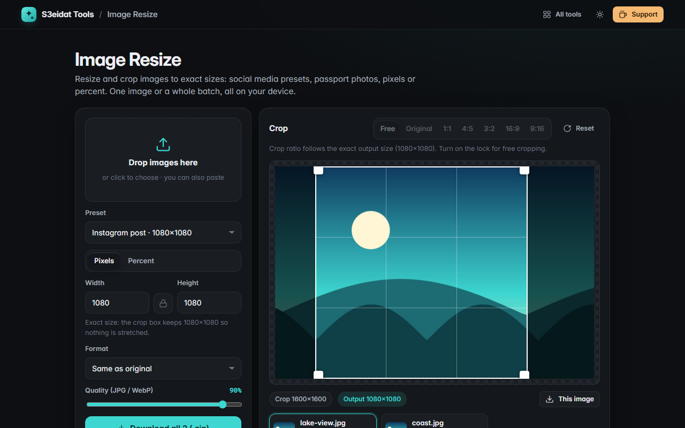

# Image Resize

> Resize and crop images to exact sizes, one at a time or in bulk. Free, private, and it runs entirely in your browser.

### ▶ [Open Image Resize](https://s3eidat.github.io/image-resize/)



## Features

- Resize by **pixels** (with an aspect-ratio lock) or by **percent** (1–400%)
- **Presets**: Instagram post and portrait, Story/Reels/TikTok, YouTube thumbnail, X header, Facebook cover,
  LinkedIn banner, Full HD, passport 35×45 mm and US 2×2 in (at 300 dpi)
- **Crop tool**: drag the box, drag a corner, or use the arrow keys (Shift+arrows resizes);
  ratios Free, Original, 1:1, 4:5, 3:2, 16:9, 9:16
- **Never stretches**: with an exact width × height the crop box locks to that shape, so you choose what's kept
- **Batch**: every image gets the same size settings and its own crop; download all as a .zip
- **High-quality downscaling** (step-down halving, then a smooth final pass)
- Output as the original format, JPG, PNG or WebP with a quality slider

## Privacy


Your images never leave your device. There is no server, no account, no analytics.
The page ships with a strict Content-Security-Policy (`connect-src 'self'`), so the browser
itself blocks any attempt to send data anywhere.

## Run it yourself

It's plain HTML, CSS and JavaScript with no build step:

```bash
git clone https://github.com/s3eidat/image-resize
cd image-resize
python -m http.server 8000
```

Then open http://localhost:8000.

## Support

If this saved you time, **[buy me a coffee ☕](https://s3eidat.github.io/coffee/)**. It keeps every tool free.

---

Part of **[S3eidat Tools](https://s3eidat.github.io/)**: 100+ free, private tools that run in your browser. MIT licensed.
